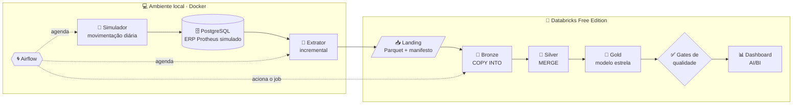
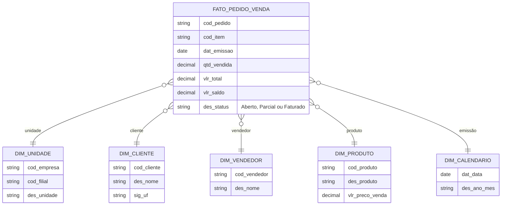
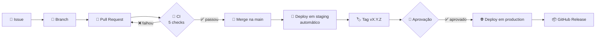

<div align="center">

# 📊 PDC — Plataforma de Dados Comercial

**Do pedido no ERP ao indicador no dashboard: pipeline de dados versionado, testado e implantado com CI/CD.**

[](https://github.com/GChandrone/pdc-plataforma-dados-comercial/actions/workflows/ci.yml)
[](https://github.com/GChandrone/pdc-plataforma-dados-comercial/actions/workflows/cd.yml)


[Arquitetura](#-arquitetura) •
[Modelo de dados](#-modelo-de-dados) •
[Qualidade](#-qualidade-de-dados) •
[CI/CD](#-cicd) •
[Como rodar](#-como-rodar) •
[Documentação](#-documentação)

</div>

---

## 🎯 O que é

Uma plataforma de dados analíticos do domínio **Comercial** que entrega, todo dia, indicadores de **vendas e carteira**
por unidade de negócio, cliente, vendedor, produto e período.

A fonte simula o ERP **TOTVS Protheus** (tabelas SC5, SC6, SA1, SA3 e SB1) com dados **100% fictícios**, e todo o
ciclo de vida segue o **Plano de Gerenciamento de Configuração (PGC)** publicado em [`docs/pgc/`](docs/pgc/).

| 🏢 Unidade de negócio | Empresa | Filial |
|---|:---:|:---:|
| Matriz | 01 | 01 |
| Acessórios | 05 | 01 |
| Nordeste | 08 | 01 |
| Centro-Oeste | 08 | 02 |
| TopMax | 13 | 01 |

---

## 🏗️ Arquitetura



| Etapa | O que acontece | Onde |
|---|---|---|
| **Fonte** | Banco PostgreSQL com tabelas por empresa (`sc5080`, `sa1130`…) e trigger que atualiza o `S_T_A_M_P_` | `erp_simulado/` |
| **Extração** | Lê apenas o que mudou desde o último watermark e envia Parquet para a landing | `extrator/` |
| **Orquestração** | DAGs diárias: simula o ERP, extrai e aciona o job do Databricks | `airflow/` |
| **Bronze** | `COPY INTO` idempotente: espelho fiel da origem | `src/ingestao/` |
| **Silver** | Nomes semânticos, tipos corretos e `MERGE` pela chave empresa + `R_E_C_N_O_` | `src/silver/` |
| **Gold** | Modelo estrela documentado (`COMMENT`) e pronto para consumo | `src/gold/` |

> 💡 **Por que a máquina local envia os dados?** A Free Edition bloqueia conexões de saída, então o Databricks não
> consegue buscar dados em bancos externos. O extrator faz o caminho inverso. Decisão registrada no
> [ADR 0001](docs/adr/0001-extracao-no-sentido-inverso.md).

### 🔁 Estratégia de carga

| Tabela | Conteúdo | Tipo de carga | Como funciona |
|---|---|:---:|---|
| **SC5 / SC6** | Pedidos de venda (cabeçalho e itens) | 🔄 Incremental | Watermark no `S_T_A_M_P_` + `MERGE` pelo `R_E_C_N_O_` |
| **SA1** | Clientes | 📸 Completa | Último snapshot por empresa |
| **SA3** | Vendedores | 📸 Completa | Último snapshot por empresa |
| **SB1** | Produtos | 📸 Completa | Último snapshot por empresa |

Exclusões do Protheus (`D_E_L_E_T_ = '*'`) chegam pela própria carga incremental e são filtradas na Gold.

---

## 🧩 Modelo de dados

Camada **Gold** (`<catálogo gold>.comercial`), no grão **item do pedido de venda**:



Colunas com prefixo semântico (`cod_`, `dat_`, `qtd_`, `vlr_`, `des_`) e descrição completa no
[dicionário de dados](docs/dicionario-dados.md).

---

## ✅ Qualidade de dados

A cada carga, o job **falha** se qualquer gate for reprovado — dado errado não chega ao dashboard.

| Gate | Verificação |
|---|---|
| 🧮 **Reconciliação** | Registros declarados no manifesto do extrator = registros que chegaram na Bronze |
| 🔑 **Chave única** | Nenhum nulo e nenhuma duplicidade em empresa + `R_E_C_N_O_` na Silver |
| 🔗 **Integridade** | Toda linha da fato encontra cliente, vendedor, produto e unidade nas dimensões |
| 📝 **Documentação** | Toda tabela da Gold possui `COMMENT` no Unity Catalog |

---

## 🚀 CI/CD



<table>
<tr>
<td width="50%" valign="top">

**🤖 CI — em todo Pull Request**

- 🧹 Lint (ruff) e verificação de catálogo fixo
- 🔒 SAST (Bandit) e varredura de segredos (gitleaks)
- 🧪 Testes unitários e de integração com PostgreSQL real
- 🐳 Build da imagem do Airflow e importação das DAGs
- 🧱 Validação do Asset Bundle do Databricks

</td>
<td width="50%" valign="top">

**🚚 CD — após o merge e a cada tag**

- 🧪 `main` → deploy automático em **staging**
- 🏷️ tag `vX.Y.Z` → aprovação manual → **production**
- 💨 Smoke test em Produção
- 📦 Release com notas geradas automaticamente
- ⏪ Rollback: reexecutar o CD da tag anterior

</td>
</tr>
</table>

### 🌍 Ambientes

| | 🧪 staging | 🌐 production |
|---|---|---|
| **Environment do GitHub** | `staging` | `production` · **aprovação obrigatória** |
| **Target do Asset Bundle** | `dev` | `prd` |
| **Catálogos** | `dev_bronze` · `dev_silver` · `dev_gold` | `bronze` · `silver` · `gold` |
| **Quando recebe deploy** | A cada merge na `main` | Tag `vX.Y.Z` aprovada |
| **Origem dos dados** | Landing compartilhada | Landing compartilhada |

> 🔒 A `main` é protegida: só aceita mudanças por Pull Request com os 5 checks verdes — nem administradores pulam
> essa regra. Versões seguem o [SemVer](https://semver.org/lang/pt-BR/) aplicado ao modelo Gold e os commits seguem
> [Conventional Commits](https://www.conventionalcommits.org/pt-br/).

---

## ⚡ Como rodar

**Pré-requisitos:** Docker Desktop · Python 3.11 · Java 17+ · Git · Databricks CLI · conta Databricks Free Edition

```bash
# 1. Configuração local
cp .env.example .env              # preencha senhas, host e token do Databricks
pip install -r requirements-dev.txt
pre-commit install

# 2. Sobe o ERP simulado e o Airflow
docker compose up -d --build      # Airflow em http://127.0.0.1:8080

# 3. Primeiro deploy no Databricks
databricks bundle deploy -t dev
databricks bundle run -t dev job_setup
```

**4.** No Airflow, rode uma única vez a DAG `dag_erp_carga_inicial`.
**5.** Depois da primeira release, a DAG `dag_comercial_diario` faz a carga diária de ponta a ponta.

<details>
<summary><b>🧰 Comandos úteis</b></summary>

```bash
docker compose exec airflow pdc-erp simular          # gera movimentação no ERP fora do agendamento
docker compose exec airflow pdc-extrator executar    # extração manual
pytest tests/unit                                    # testes unitários (PySpark local)
ruff check . && python .github/scripts/verificar_isolamento.py
```

</details>

<details>
<summary><b>⏪ Rollback e recuperação</b></summary>

1. **Código:** reexecutar o workflow **CD** da tag anterior e, na máquina local,
   `git checkout <tag-anterior> && docker compose up -d --build`.
2. **Dados:** restaurar a tabela com Time Travel e, se preciso, retroceder o watermark:
   ```sql
   RESTORE TABLE silver.protheus.sc6 TO VERSION AS OF <versão>;
   UPDATE controle.ingestion_control SET ultimo_watermark = '<data-hora UTC>' WHERE tabela = 'sc6';
   ```
3. **Contenção:** desligar a extração da tabela com `"ativo": false` em `conf/ingestao.json` (via PR).

</details>

<details>
<summary><b>🔄 Fluxo de uma mudança, passo a passo</b></summary>

1. Abrir uma issue (Funcionalidade, Correção ou Mudança de dados).
2. Criar a branch `feature/<issue>-<descrição>` e commitar, por exemplo `feat(gold): inclui vlr_desconto`.
3. Abrir o Pull Request com `Closes #<issue>` e aguardar os 5 checks.
4. Merge na `main` → deploy automático em **staging**.
5. `git tag vX.Y.Z && git push origin vX.Y.Z` → aprovar em **Actions › CD › Review deployments**.
6. Atualizar o ambiente local: `git checkout vX.Y.Z && docker compose up -d --build`.

</details>

---

## 📁 Estrutura

```text
📦 pdc-plataforma-dados-comercial
 ┣ 📂 .github        → workflows de CI/CD, templates de PR/issue e scripts
 ┣ 📂 airflow        → DAGs e Dockerfile
 ┣ 📂 conf           → ingestao.json · simulador.json
 ┣ 📂 docs           → PGC · ADRs · dicionário de dados · evidências
 ┣ 📂 erp_simulado   → DDL, carga inicial e simulador do Protheus
 ┣ 📂 extrator       → extrator incremental (Python)
 ┣ 📂 resources      → jobs e dashboard do Asset Bundle
 ┣ 📂 setup          → criação de catálogos, schemas e landing
 ┣ 📂 src            → Bronze · Silver · Gold · qualidade · pdc_lib
 ┣ 📂 tests          → testes unitários e de integração
 ┣ 📜 databricks.yml → Asset Bundle (targets dev e prd)
 ┗ 📜 docker-compose.yml → PostgreSQL + Airflow
```

---

## 📚 Documentação

| Documento | Descrição |
|---|---|
| 📘 [Plano de Gerenciamento de Configuração](docs/pgc/) | O PGC do projeto — item de configuração versionado |
| 🧭 [ADRs](docs/adr/) | Decisões de arquitetura e suas justificativas |
| 📖 [Dicionário de dados](docs/dicionario-dados.md) | Tabelas e colunas da camada Gold |
| 🧾 [Evidências](docs/evidencias/) | Proteção da `main`, environments e push direto recusado |
| 📝 [CHANGELOG](CHANGELOG.md) | Histórico de versões |

---

<div align="center">

👥 **Equipe:** Gabriel e André — Engenharia de Dados

🔐 Somente dados fictícios: CPF/CNPJ com dígito verificador inválido e nenhum documento levado à Silver (LGPD).

</div>
