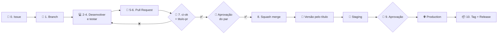

# 🛠️ Guia de desenvolvimento — da issue até Produção

Este guia descreve, passo a passo, como uma mudança sai da ideia e chega ao ambiente de **production**,
seguindo o processo de controle de mudanças do [Plano de Gerenciamento de Configuração](pgc/) (seção 8).

> **Regra de ouro:** pessoas decidem (o que mudar, quando integrar, quando liberar); a automação executa
> (testar, implantar e registrar). Nada é alterado manualmente em Produção.

---

## 🗺️ Visão geral



| Etapa | Onde acontece |
|---|---|
| Issue, branch, PR, CI, merge, versão, aprovação, tag e Release | GitHub |
| Escrever o código e rodar os testes locais | VS Code (máquina local) |
| Executar o pipeline e conferir tabelas, jobs e dashboard | Databricks |
| PostgreSQL do ERP simulado, extrator e Airflow | Docker (máquina local) |

---

## ✅ Pré-requisitos (uma única vez)

1. Ferramentas instaladas: Git, GitHub CLI (`gh`), Python 3.11, Java 17+, Docker Desktop e Databricks CLI.
2. Login na GitHub CLI: `gh auth login`.
3. Ambiente local preparado:
   ```bash
   cp .env.example .env              # preencher senhas, DATABRICKS_HOST e DATABRICKS_TOKEN
   pip install -r requirements-dev.txt
   pre-commit install
   docker compose up -d --build
   ```
4. Os comandos deste guia usam o **Git Bash** (Windows) ou o terminal do Linux/Mac.

---

## 1️⃣ Planejamento

### Passo 0 — Abrir a issue

Toda mudança começa com uma issue, que registra **o que** será feito e **por quê**.

- **Pelo navegador:** *Issues › New issue* e escolha o template: Funcionalidade, Defeito ou Mudança de alto risco (CCM).
- **Pelo terminal:**
  ```bash
  gh issue create --title "Incluir vlr_desconto na fato_pedido_venda" --label feat
  ```

Anote o número da issue (nos exemplos abaixo, **#15**). Se a mudança se encaixar nos critérios do CCM
(mudança incompatível na Gold, regra de negócio de indicador, RESTORE ou reprocessamento em Produção, LGPD
ou hotfix), use o formulário **Mudança de alto risco (CCM)** e aguarde a decisão registrada antes de implementar.

### Passo 1 — Criar a branch ligada à issue

```bash
git checkout main
git pull
gh issue develop 15 --name feature/15-vlr-desconto --checkout
```

| Tipo de mudança | Padrão de nome da branch |
|---|---|
| Funcionalidade | `feature/<issue>-<descricao-curta>` |
| Correção | `fix/<issue>-<descricao-curta>` |
| Correção emergencial em Produção | `hotfix/<descricao-curta>` |

---

## 2️⃣ Desenvolvimento

### Passo 2 — Desenvolver no VS Code

| O que mudar | Onde |
|---|---|
| Regras de transformação e qualidade | `src/pdc_lib/` |
| Notebooks Bronze, Silver, Gold e qualidade | `src/ingestao/`, `src/silver/`, `src/gold/`, `src/qualidade/` |
| Jobs e dashboard do Databricks | `resources/`, `src/dashboards/` |
| Extração e ERP simulado | `extrator/`, `erp_simulado/`, `conf/` |
| DAGs do Airflow | `airflow/dags/` |
| Testes | `tests/unit/`, `tests/integration/` |

Boas práticas do projeto:

- Nunca escreva o nome de um catálogo de forma fixa (ex.: `silver.protheus.sc5`): use sempre o parâmetro do job.
- Toda coluna nova da Gold precisa de descrição em `src/pdc_lib/comentarios.py`.
- Somente dados fictícios: nada de dados reais, tokens ou senhas no código.

### Passo 3 — Validar localmente

```bash
ruff check .
python .github/scripts/verificar_isolamento.py
pytest tests/unit
```

Para o teste de integração, use **sempre** o banco de teste (ele apaga as tabelas antes de rodar):

```bash
PG_HOST=localhost PG_DB=erp_protheus_teste PG_USER=<usuario> PG_PASSWORD=<senha> \
  pytest tests/integration -m integration
```

### Passo 4 — Testar no Databricks (opcional)

Recomendado quando a mudança altera notebooks, jobs ou o dashboard. Publica a **sua branch** no target `dev`
(catálogos `dev_*`, jobs com o prefixo do seu usuário):

```bash
databricks bundle deploy -t dev
databricks bundle run -t dev job_comercial_diario
```

Confira o resultado no Databricks (Catalog, Jobs & Pipelines e o dashboard de Desenvolvimento).
Os catálogos `dev_*` são compartilhados: combine com o colega antes de testar ao mesmo tempo.

---

## 3️⃣ Integração

### Passo 5 — Commitar e enviar

Mensagens no padrão [Conventional Commits](https://www.conventionalcommits.org/pt-br/):

```bash
git add .
git commit -m "feat(gold): inclui vlr_desconto na fato_pedido_venda"
git push -u origin feature/15-vlr-desconto
```

| Tipo | Uso | Escopos comuns |
|---|---|---|
| `feat` | Nova funcionalidade | `bronze`, `silver`, `gold`, `dag`, `dashboard` |
| `fix` | Correção | `extrator`, `erp`, `infra` |
| `docs` | Documentação | — |
| `test`, `refactor`, `ci`, `chore` | Testes, refatoração, pipeline e manutenção | `ci`, `deps` |

O **pre-commit** roda automaticamente no commit (ruff, gitleaks e limpeza dos outputs dos notebooks) e
bloqueia o commit se encontrar algum problema.

### Passo 6 — Abrir o Pull Request com auto-merge

```bash
gh pr create --fill --body "Closes #15"
gh pr merge --auto --squash
```

Preencha o checklist do template do PR. O **título do PR** deve seguir o padrão Conventional Commits, porque
ele vira a mensagem do commit na `main` (squash merge). Peça a revisão ao seu par:

```bash
gh pr edit --add-reviewer GabBruno
```

O merge exige **1 aprovação do par de revisão**: o GitHub não permite aprovar o próprio PR, e um novo commit
descarta a aprovação anterior.

### Passo 7 — Acompanhar o CI

```bash
gh pr checks --watch
```

| Check | O que verifica |
|---|---|
| `titulo-pr` | Título do PR em Conventional Commits (obrigatório) |
| Lint, testes e cobertura | ruff, catálogo fixo, Bandit, testes unitários e de integração, cobertura ≥ 60% |
| Análise de dependências (SCA) | Dependência nova com vulnerabilidade crítica |
| Varredura de segredos (gitleaks) | Tokens e senhas no histórico |
| Build do Airflow e importação das DAGs | Dockerfile e DAGs válidos |
| Validação do Asset Bundle | `databricks.yml` e `resources/` válidos |
| `ci-ok` | Resumo de todos os jobs acima (obrigatório) |

Somente `ci-ok` e `titulo-pr` são obrigatórios na proteção da `main` (ADR 0004). Se algum check falhar:
abra *Details* no PR, corrija na mesma branch, faça um novo commit e `git push`. Se o problema for o
título, basta editar o título do PR.

### Passo 8 — Merge e deploy em staging (automáticos)

Com `ci-ok` e `titulo-pr` verdes e a aprovação do par, o GitHub faz o **squash merge** (o título do PR vira
o commit na `main`), apaga a branch e fecha a issue. O CD então:

1. calcula a versão a partir dos títulos dos PRs desde a última tag;
2. gera o **pacote** uma única vez;
3. publica o pacote em **staging** (target `dev`) e roda o job com os gates de qualidade.

```bash
gh run list --workflow cd.yml --limit 3
gh run watch
```

| Título do PR mesclado | Versão |
|---|---|
| `feat(...): ...` | MINOR — `v1.0.0` → `v1.1.0` |
| `fix(...): ...` ou `perf(...): ...` | PATCH — `v1.0.0` → `v1.0.1` |
| `feat!: ...` ou `BREAKING CHANGE:` na descrição | MAJOR — `v1.1.0` → `v2.0.0` (aciona o CCM) |
| `docs`, `chore`, `ci`, `test`, `refactor`, `style` | sem versão nova; produção não roda |

PRs que alteram só `docs/` ou arquivos `.md` nem disparam o CD.

---

## 4️⃣ Produção

### Passo 9 — Aprovar o deploy

Quando há versão nova, o job **Produção** do CD fica em *Waiting for review*:
*Actions › CD › (execução do merge) › Review deployments › production › Approve and deploy*.

Antes de aprovar, confira o resultado de staging (job executado e gates de qualidade aprovados) e,
se quiser, baixe o pacote em **Artifacts**.

### Passo 10 — Conferir a baseline

Aprovado, o CD publica o **mesmo pacote** no target `prd`, roda o smoke test e cria a baseline:
tag `vX.Y.Z` + Release com as notas (Funcionalidades, Correções, Outros) e o `.zip` anexado.

```bash
gh release view v1.1.0
```

Confira também o registro em *Settings › Environments › production* (quem aprovou e quando).

### Passo 11 — Atualizar o ambiente local

Necessário quando a mudança alterou o extrator, o ERP simulado ou as DAGs:

```bash
git fetch --tags
git checkout v1.1.0
docker compose up -d --build
git checkout main
```

---

## ⚡ Resumo em uma tela

```bash
# Planejamento
gh issue create --title "..." --label feat
git checkout main && git pull
gh issue develop 15 --name feature/15-descricao --checkout

# Desenvolvimento
ruff check . && python .github/scripts/verificar_isolamento.py && python -m pytest tests/unit
databricks bundle deploy -t dev && databricks bundle run -t dev job_comercial_diario   # opcional

# Integração (o título do PR define a versão)
git add . && git commit -m "feat(gold): descrição"
git push -u origin feature/15-descricao
gh pr create --title "feat(gold): descrição" --body "Closes #15"
gh pr edit --add-reviewer GabBruno
gh pr merge --auto --squash
gh pr checks --watch

# Produção (após o merge): aprovar em Actions › CD › Review deployments
gh run watch
gh release view v1.1.0
```

---

## ⏪ Rollback

1. **Código:** *Actions › Rollback › Run workflow*, informe a tag estável (ex.: `v1.0.0`) e aprove em
   *Review deployments*. O workflow baixa o pacote anexado à Release, publica de novo no target `prd`
   sem recompilar, roda o job e marca a Release como **Latest**.
   ```bash
   gh workflow run rollback.yml -f tag=v1.0.0
   ```
2. **Ambiente local:** `git checkout v1.0.0 && docker compose up -d --build`.
3. **Dados:** restaure a tabela com Time Travel e, se necessário, retroceda o watermark:
   ```sql
   DESCRIBE HISTORY silver.protheus.sc6;
   RESTORE TABLE silver.protheus.sc6 TO VERSION AS OF <versão>;
   UPDATE controle.ingestion_control SET ultimo_watermark = '<data-hora UTC>' WHERE tabela = 'sc6';
   ```
4. **Correção da `main`:** branch `revert/<descricao>`, `git revert <commit>` e PR com título `revert: ...`.
5. **Contenção:** desligue a extração da tabela com `"ativo": false` em `conf/ingestao.json` (via PR).
6. Registre o incidente e as ações em uma issue.

---

## 🤖 Pull Requests do Dependabot

O Dependabot abre PRs agrupados com atualizações **MINOR** e **PATCH** de bibliotecas, Actions e imagem Docker.
O título deles começa com `chore(deps)` (ou `ci` para as Actions), passa no `titulo-pr` e não gera
versão nova. Eles passam pelo mesmo CI. Antes de mesclar, leia as notas da nova versão (*Release notes* na
descrição do PR). Com `ci-ok` verde:

1. Peça a aprovação do par de revisão; depois clique em *Squash and merge*.
2. Se houver mais de um PR, após o primeiro merge use *Update branch* (ou comente `@dependabot rebase`) nos demais.
3. As atualizações chegam a Produção junto com a próxima versão (`feat` ou `fix`).
4. Se o CI quebrar, comente no PR o que quebrou e feche **sem** mesclar.

Versões **MAJOR** são ignoradas automaticamente e exigem avaliação manual (CCM).

---

## 🧯 Problemas comuns

| Sintoma | Causa provável | Solução |
|---|---|---|
| Commit bloqueado pelo pre-commit | ruff, gitleaks ou notebook com outputs | Leia a mensagem, corrija e commite de novo (o ruff já aplica correções simples) |
| Check "Lint, testes e cobertura" vermelho | Lint, catálogo fixo, Bandit, teste ou cobertura abaixo de 60% | Rode `ruff check .`, `python .github/scripts/verificar_isolamento.py` e `python -m pytest tests` localmente |
| `titulo-pr` vermelho | Título fora do Conventional Commits | Edite o título do PR (ex.: `fix(extrator): corrige watermark`) |
| PR preso em *Expected — Waiting for status* | Check obrigatório que não roda | Deixe só `ci-ok` e `titulo-pr` como obrigatórios |
| Job **Produção** aparece como *skipped* | Nenhum `feat`/`fix` desde a última tag | Esperado: não há versão nova |
| *Resource not accessible by integration* ao criar a tag | Permissão do token do Actions | *Settings › Actions › General › Workflow permissions* → *Read and write* |
| Botão de merge bloqueado com checks verdes | Falta a aprovação do par ou a branch está desatualizada | Peça a revisão (`gh pr edit --add-reviewer GabBruno`) ou clique em *Update branch* |
| Par não consegue aprovar o PR | Convite de colaborador não aceito | O par aceita o convite em github.com/notifications |
| Deploy em production parado | Aguardando aprovação | *Actions › CD › Review deployments* |
| Environment `dev` ou `prd` reaparece | Branch antiga com workflow antigo | Atualize ou feche a branch e exclua o environment |
| Job falha nos gates de qualidade | Dado inconsistente na carga | Veja a mensagem do notebook `qualidade_dados` no Databricks e abra uma issue de correção |
| `push` direto na `main` recusado | Proteção da branch (comportamento esperado) | Use uma branch e um Pull Request |
